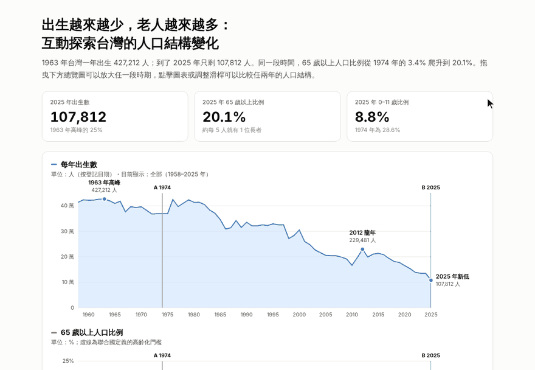
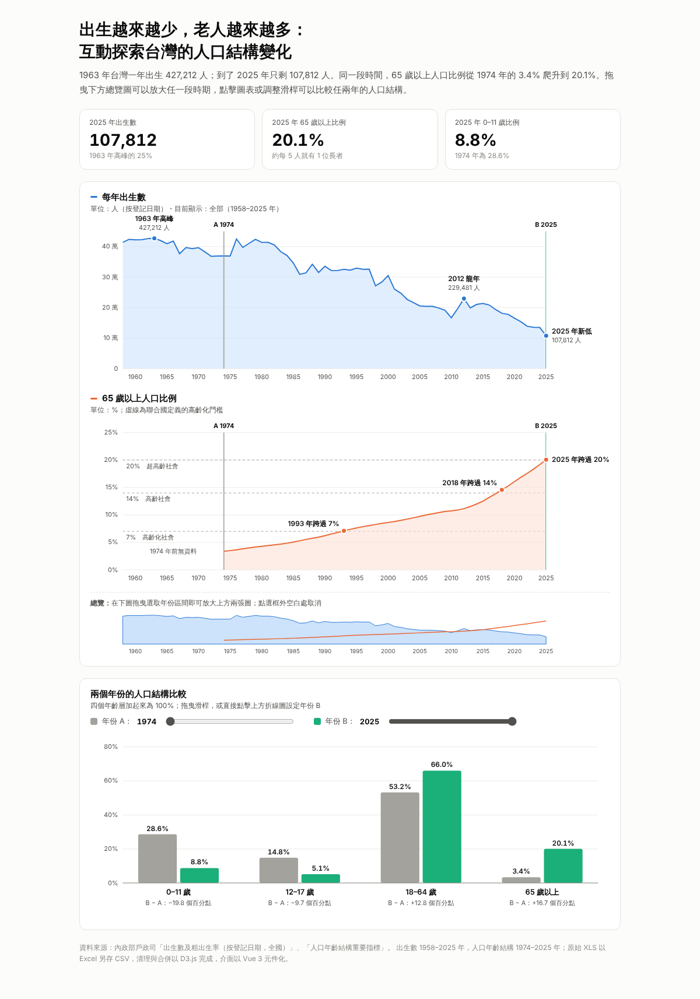
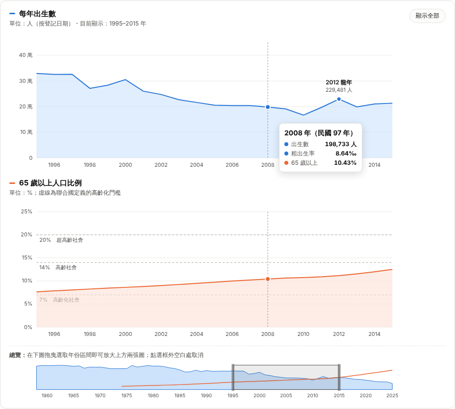
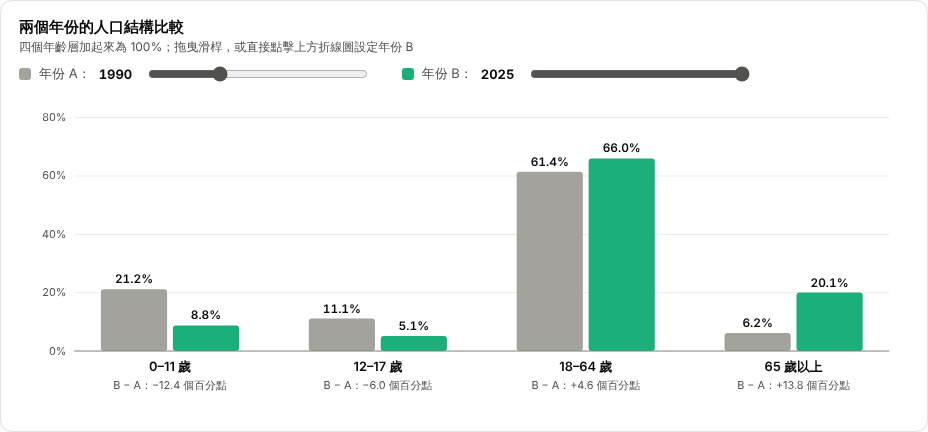

# 1151VIS-HW2：互動探索台灣的人口結構變化（Vue 3 + D3.js 動態視覺化）

- 學號／姓名：414085208／曾辰哲

## 1. 專案截圖

執行錄影：刷選放大 → 滑鼠查看數值 → 點擊設定比較年份 → 顯示全部 → 拖曳滑桿比較兩個年份。



整體畫面：



刷選放大到 1995–2015 年，滑鼠停在 2008 年：



年度比較長條圖（1990 年 vs 2025 年）：



## 2. GitHub 連結

- HW2 repository：https://github.com/Irving0522/1151VIS-HW2-414085208-TsengChenChe
- GitHub Pages 線上展示：https://irving0522.github.io/1151VIS-HW2-414085208-TsengChenChe/
- 執行錄影 GIF：[images/demo.gif](images/demo.gif)
- 延續的 HW1：https://github.com/Irving0522/1151VIS-HW1-414085208-TsengChenChe

## 3. 主題、資料與使用技術

### 3-1. 主題與資料

**主題：** HW1 用靜態圖呈現台灣少子化與高齡化的長期趨勢。HW2 在同一份資料上加入兩種動態互動，讓使用者可以自己探索：

1. **刷選放大（Brush & Zoom）：** 在總覽圖拖曳選取任一段時期，上方兩張主圖會平滑放大到那段期間。
2. **年度比較長條圖：** 任選兩個年份，以分組長條圖比較四個年齡層的人口比例。切換年份時，長條會用動畫變化到新的高度。

**資料來源：** 內政部戶政司「人口統計資料 → 快速下載」

| 檔案 | 內容 | 年份 |
|---|---|---|
| 出生數及粗出生率按登記及發生.xls（工作表「全國(登記)」） | 每年出生數、粗出生率 | 1958–2025 |
| 人口年齡結構指標.xls | 各年齡層人口數與比例 | 1974–2025 |

### 3-2. 使用技術

| 技術 | 用途 |
|---|---|
| Vue 3（`<script setup>` 單檔元件） | 元件化、響應式狀態（刷選範圍、比較年份、hover 同步） |
| D3.js v7 | 資料清理、比例尺、路徑計算、`d3.brushX` 刷選、`d3.interpolate` + `d3.timer` 補間動畫 |
| Vite | 開發伺服器與打包 |

**Vue 與 D3 的分工：** D3 負責「計算」和「刷選互動」，Vue 負責把 SVG「畫出來」。動畫的做法是：用 D3 把數值從舊值補間到新值，每一個畫面都更新 Vue 的響應式資料，Vue 再自動重畫 SVG。

## 4. 說明製作流程和相關操作

### 4-1. 製作流程：動態效果的實作方式

#### (1) 補間動畫工具 `useTween`（`src/composables/useTween.js`）
兩種動態效果共用這個工具：

1. 用 `watch` 監聽目標值，例如刷選範圍或年度比例。
2. 目標一改變，就用 `d3.interpolate(目前值, 新目標)` 建立補間函式。
3. 用 `d3.timer` 在每個畫面計算進度 `t`，套上 `d3.easeCubicInOut` 緩動，把結果寫回 Vue 的 `ref`。
4. Vue 偵測到 `ref` 改變，就重畫圖表，形成動畫。
   - 注意：`d3.interpolate` 處理陣列時會重複使用同一個輸出物件，必須複製一份，Vue 才偵測得到變化。

#### (2) 刷選放大（`BrushOverview.vue` + `LineChart.vue`）

| 步驟 | 做法 |
|---|---|
| 刷選 | `d3.brushX()` 掛在總覽圖的 `<g>` 上，拖曳結束時用 `x.invert()` 把像素換回年份，並對齊到整數年 |
| 傳遞 | 子元件用 `v-model` 回傳範圍 `[起, 迄]`，存在 `App.vue` 的 `zoom` |
| 動畫 | `viewDomain = useTween(zoom ?? 全部年份)`，x 軸範圍在 700 ms 內平滑變化 |
| 主圖 | 兩張 `LineChart` 都接收 `viewDomain`，比例尺、刻度、標註跟著更新；用 `clipPath` 裁掉框外的線 |
| 取消 | 按「顯示全部」，或點總覽圖的空白處；外部清除時用 `brush.move` 同步移除選取框 |

#### (3) 年度比較長條圖（`AgeCompareChart.vue`）

| 步驟 | 做法 |
|---|---|
| 年齡分組 | 0–11、12–17、65 歲以上取自原始資料；18–64 歲 = 100 − 其他三組，四組加總剛好 100% |
| 選年份 | 兩個 `<input type="range">` 用 `v-model` 綁定年份 A、B；也可以直接點上方折線圖，把點到的年份設為 B |
| 動畫 | 兩組比例各自經過 `useTween`，切換年份時長條高度和數字標籤一起平滑變化 |
| 版面 | `d3.scaleBand` 做兩層分組（年齡層 → A／B），每組下方標出「B − A」差了幾個百分點 |
| 連動 | 選中的 A、B 年份會在上方兩張折線圖畫出垂直線，同步顯示 |

#### (4) 沿用 HW1 的功能
- 資料清理：用 D3 讀取 Excel 另存的原始 CSV，自動判斷編碼、民國年換算、依年份合併（`src/utils/population.js`）。
- 兩張圖同步的 hover 提示框。
- 門檻線（7%／14%／20%）與重要年份標註，都由資料計算，不寫死。

### 4-2. 相關操作：執行方式與互動說明

需要先安裝 [Node.js](https://nodejs.org/)（建議 20 以上的版本）。

```bash
npm install        # 第一次執行時安裝套件
npm run dev        # 啟動開發伺服器，打開終端機顯示的網址（通常是 http://localhost:5173）
```

| 操作 | 方法 |
|---|---|
| 放大某段時期 | 在「總覽」小圖上按住滑鼠左右拖曳 |
| 調整放大範圍 | 拖曳選取框本身可以平移，拖曳兩側把手可以縮放 |
| 回到全部年份 | 按右上角「顯示全部」，或點總覽圖選取框以外的地方 |
| 查看某一年數值 | 滑鼠移到折線圖上 |
| 設定比較年份 | 拖曳「年份 A／年份 B」滑桿，或直接點擊折線圖（設為年份 B） |
| 檢查資料 | 按 F12 開啟 Console，可以看到最後三年的資料表 |

### 4-3. GitHub 上傳與分享流程

1. **建立 repository：** 名稱設為 `1151VIS-HW2-414085208-TsengChenChe`，Visibility 選 Public，`.gitignore` 選 HTML。
2. **上傳專案：** 把專案資料夾中除了 `node_modules`、`dist` 以外的所有檔案上傳，然後 Commit。
3. **分享給老師：** Settings → Collaborators → Add people，輸入 `cchu.fju@gmail.com`。
4. **執行與錄影：** 執行 `npm run dev`，錄下刷選放大、年份比較等關鍵操作。

### 4-4. 檔案結構

```
1151VIS-HW2-414085208-TsengChenChe/
├── index.html
├── package.json / package-lock.json / vite.config.js / .gitignore
├── README.md
├── public/data/
│   ├── births_raw.csv            出生數原始 CSV
│   └── age_raw.csv               年齡結構原始 CSV
├── src/
│   ├── main.js
│   ├── style.css                 全域樣式與顏色變數
│   ├── App.vue                   主頁面：集中管理 zoom、yearA/B、hover 狀態
│   ├── utils/population.js       D3 資料載入與清理
│   ├── composables/useTween.js   【HW2 新增】D3 補間動畫工具
│   └── components/
│       ├── StatCards.vue         數字卡
│       ├── LineChart.vue         折線＋面積圖（支援動態 x 範圍、clipPath、點擊選年）
│       ├── BrushOverview.vue     【HW2 新增】總覽小圖＋d3.brushX 刷選
│       ├── AgeCompareChart.vue   【HW2 新增】年度比較分組長條圖
│       └── HoverTooltip.vue      滑鼠提示框
└── images/                       截圖與錄影 GIF
```
